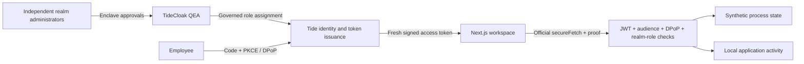

# Project overview

**CloudGuard — Zero-Trust Infrastructure Governance** lets teams share infrastructure operations through TideCloak-governed privileges and server-verified access.

### What new product, service, experience or way of working are you proposing? What makes your idea distinctive?

A shared operations workspace where becoming an infrastructure operator requires genuine quorum governance, allowing collaborating teams to delegate work without giving one realm administrator unilateral privilege-granting authority.

### What is difficult, risky or impossible today because trust, privacy or security gets in the way? Explain what becomes possible when that constraint is removed.

Ordinary IAM administrators can rewrite who holds operating privileges. Governed role assignment enables shared operations while reducing that concentration of authority within the enrolled realm-admin boundary.

### Who would benefit, and how would their lives or work improve? Give a concrete example of why this matters.

Platform teams and partner organizations could delegate incident response with shared oversight: an employee gains operating access only after independent administrators approve, rather than trusting one privileged account.

### How does your application use TideCloak, and how does that integration help enable your idea? Connect the technology to the possibility you are demonstrating.

TideCloak supplies identity, signed tokens and QEA-governed realm roles. The API verifies pinned keys, issuer, client/audience, expiry, DPoP and infra-operator. Three enrolled administrators are intended to require two approvals; verify the effective policy in Tide Console. Master administration remains outside QEA.

### What does your prototype demonstrate today? Describe the key interaction judges should look for.

Four pages, three synthetic resources, protected restarts and logs. Automated tests cover viewer rejection and operator success. A licensed QEA realm is provisioned; human enrollment and live quorum verification remain pending. Target: 403 → genuine independent approvals → fresh employee claims → 200. No genuine demo MP4 is included yet.

---

## Requirements and quick start

Node.js ≥20.19, npm, Docker Engine, curl, jq, and access to Tide's network. Commands run from this repository's root.

```bash
npm ci
cp .env.example .env
chmod 600 .env
# Edit .env: choose a strong master password, enter your licence email,
# and set TIDE_TERMS_ACCEPTED=yes only after accepting https://tide.org/legal.
npm run init
# Complete the genuine Tide enrollment link; let bootstrap finish.
npm run dev
```

Open **http://localhost:3000**. Keep the exact origin: the client includes signed origin capabilities. Stop with `npm stop` or Ctrl+C for the app terminal. See [complete setup and restart instructions](docs/SETUP.md), including Docker socket diagnosis and preserving existing data.

Without a genuine adapter, the public UI renders an explicit setup notice and protected APIs fail closed. No mock login exists. For a production build: `npm run build && npm start`.

## Authentication and governance

The official Tide Next.js provider performs authorization-code/PKCE authentication with strict DPoP. The public client adapter is exported through Tide's vendor endpoint and stored locally in `data/tidecloak.json`. Only allowlisted public SDK inputs are served; operator secrets never reach the browser.

Default user privileges include the realm role `viewer`. Only the verified realm role `infra-operator` permits `POST /api/resources/{id}/restart`. The other authenticated APIs expose resources, synthetic health, verified session metadata and shared application activity. No application endpoint grants roles or approves changes.

Provision **three separate enrolled people** holding `realm-management/tide-realm-admin`, plus an Employee. In the [real Tide Console](http://localhost:8080/realms/cloudguard/tide-console/), propose the Employee's infra-operator grant and independently approve through QEA. Confirm the actual threshold and that one approval remains insufficient. Obtain a fresh employee token and repeat the restart. Follow [setup](docs/SETUP.md) and the [timed demo and manual acceptance script](docs/DEMO_SCRIPT.md).

## Workspace

| Page | Implemented behavior |
|---|---|
| `/` | Product explanation, real Tide sign-in, workspace navigation |
| `/dashboard` | Protected fleet data, resource search, synthetic telemetry, health/details, API-backed restart, denial/success messages |
| `/governance` | Server-verified identity/realm roles, access status, fresh-login guidance, genuine console link; intended quorum clearly separated from live state |
| `/activity` | Shared process activity, outcome filters, JSON export; distinct from Tide's QEA audit |

All servers and operations are synthetic. No SSH, cloud account, database operation, or host restart occurs. UI access labels do not authorize the backend.

## Architecture



Source: `src/app` pages and route handlers, `src/components` UI, `src/lib/auth` token/proof enforcement, `src/lib/store.ts` bounded synthetic state and logs. `scripts` contains the adapted official bootstrap and local operator diagnostics. Tailwind CSS, shadcn-style Radix/CVA Button, Lucide icons, TypeScript, Next.js, React, official Tide SDKs and jose form the stack. Dependencies are locked in `package-lock.json`.

## Testing and current status

```bash
npm run lint
npm run typecheck
npm test
npm run build
npm run test:integration
npm run test:browser
npm audit --omit=dev
```

Tests exercise the real official verifier and signed ephemeral test JWT/DPoP inputs, role spoofing rejection, 401/403/503 behavior, resource validation, idempotency, cooldown and logs. They are **not proof of live Tide issuance or QEA**. Browser tests cover navigation, mobile layout, unauthenticated protected endpoints and the exact official DPoP relay. Playwright can use local Chrome or installed Chromium.

Tide MCP v1.9.33 is operational. The official container is running locally; the licensed CloudGuard realm reports QEA enabled with Tide attestation and required realm roles. First-admin enrollment and the live multi-admin acceptance test remain pending. See [validation evidence](docs/VALIDATION.md).

Runtime dependency audit is clean. Five high-severity development-tool findings remain through braces in Next's lint dependency tree, with no fixed current braces version; details in [SECURITY.md](docs/SECURITY.md).

## Security limits

Tide protects the governed privilege assignment and token authority, not each simulated restart. The master realm is outside QEA. A compromised app host can replace enforcement or trusted configuration. Existing tokens retain privileges until expiry. Replay/idempotency caches and synthetic state are in memory: use one Node process; restart/multi-instance durability requires a shared atomic store. Logs are application records, not cryptographic evidence. Read the full [trust boundary and limitations](docs/SECURITY.md).

## Submission assets

The overview above uses the **five exact official prompts** retrieved from [Tide UNLOCKED's public configuration](https://tide.org/unlocked/config.js); it is under 300 words including prompts. Setup is separate.

A genuine MP4 (≤2 minutes, <100 MB) still needs to be recorded and added after the real QEA flow is verified. The [storyboard](docs/DEMO_SCRIPT.md) provides evidence and export requirements. Submit the repository through the [official form](https://forms.gle/HRHYjnqB86j1LFS97); pushing code alone is not submission. Deadline displays conflict across the site's static text and timezone-specific configuration; verify with organizers as described in the demo script.

Original submission repository: **HCMUS_SGS_Fourdogs_C2** — Tide UNLOCKED, RMIT Hackathon 2026, Challenge 2.
